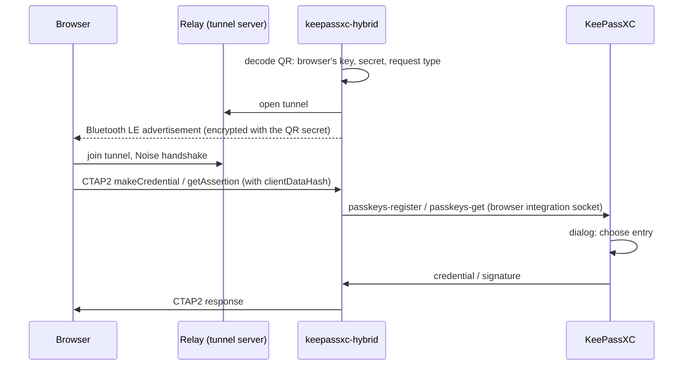

# keepassxc-hybrid

Use KeePassXC passkeys through the "use your phone or tablet" QR code a browser shows.

When a site asks for a passkey, browsers can show a QR code for a phone to scan.
The phone then acts as the authenticator: it proves it is nearby over Bluetooth
LE and answers the request through an internet relay (the WebAuthn *hybrid*
transport, also called caBLE). `keepassxc-hybrid` plays the phone's part on
a Linux machine and hands the request to KeePassXC, which asks you:

- to **register** a passkey: create a new entry, or add it to an existing entry;
- to **sign in**: pick the passkey.

It works with any browser on any device that offers the QR code, including
other computers near this one.

## Usage

Give it the QR code as a screenshot, from a file or from stdin:

```sh
keepassxc-hybrid screenshot.png
grim -g "$(slurp)" - | keepassxc-hybrid -     # select the QR code on screen
keepassxc-hybrid 'FIDO:/1234…'                # the decoded URL also works
```

A whole-screen capture works too; the tool finds the `FIDO:/` code in it.

For a key binding, for example in niri:

```kdl
binds {
    Mod+Shift+P { spawn "sh" "-c" "grim - | keepassxc-hybrid - || notify-send 'keepassxc-hybrid failed'"; }
}
```

Options: `--group NAME` puts new passkey entries in that KeePassXC group;
`--tunnel-server 1` uses Apple's relay instead of Google's; `--timeout SECS`
(default 180) bounds the wait for the browser.

The first run asks KeePassXC to approve the tool, like the browser extension
does when you connect it. Give it a name; the approval is stored in
`~/.config/keepassxc-hybrid/associations.json`.

## Requirements

- **KeePassXC 2.7.7 or later, with browser integration on**: Settings > Browser
  Integration > Enable browser integration. No browser needs to be ticked.
- **For signing in, KeePassXC with
  [`patches/keepassxc-passkeys-client-data-hash.patch`](patches/keepassxc-passkeys-client-data-hash.patch).**
  In the hybrid transport the browser builds the client data and sends only
  its hash. KeePassXC's browser API builds its own client data, so stock
  KeePassXC signs the wrong data. The patch adds a `clientDataHash` option to
  `passkeys-get`. Without it the tool refuses to send the signature.
  Registering works on stock KeePassXC, because KeePassXC uses `none`
  attestation: nothing it returns at registration depends on the client data.
- **A Bluetooth LE adapter that can advertise**, through BlueZ.
- **The browser on another device, or a second Bluetooth adapter.** A browser
  scans for the advertisement before it uses the relay, and a Bluetooth
  adapter does not receive its own advertisements. For a browser on the same
  machine, the KeePassXC-Browser extension is the simpler route.

## NixOS

The flake's overlay adds `keepassxc-hybrid` and patches `keepassxc`:

```nix
{
  inputs.keepassxc-hybrid.url = "github:johnrichardrinehart/keepassxc-hybrid";

  # in a NixOS module
  nixpkgs.overlays = [ inputs.keepassxc-hybrid.overlays.default ];
  environment.systemPackages = [ pkgs.keepassxc pkgs.keepassxc-hybrid ];
}
```

`nix run github:johnrichardrinehart/keepassxc-hybrid -- screenshot.png` runs it
without installing.

## How it works



- The caBLE protocol comes from
  [`webauthn-authenticator-rs`](https://github.com/kanidm/webauthn-rs). Its
  authors describe the caBLE implementation as incomplete and not reviewed for
  cryptographic security. The tool uses a
  [fork](https://github.com/johnrichardrinehart/webauthn-rs/tree/cable-assertion-user-handle)
  that returns the user handle in sign-in responses, which sites need to find
  the account for a passkey sign-in without a username.
- KeePassXC is reached the way KeePassXC-Browser reaches it: NaCl-encrypted
  JSON over `$XDG_RUNTIME_DIR/app/org.keepassxc.KeePassXC/org.keepassxc.KeePassXC.BrowserServer`.
- The tool tells the browser it verifies the user, as phones do, and asks
  KeePassXC for user verification. The CTAP request does not say whether the
  site requires it, and most sites do.
- KeePassXC records `https://<rp id>` as the entry URL; the browser has
  already checked the real origin.

## Development

```sh
nix develop
cargo test
scripts/live-test.sh
```

`scripts/live-test.sh` registers a passkey and signs in with it through the
same CTAP messages a browser sends, against a throwaway KeePassXC (this
flake's patched build) and database in a headless sway, and checks both with
`webauthn-rs` as the site. It answers KeePassXC's dialogs with keystrokes;
`KEEP=dir` keeps screenshots of them. The relay and Bluetooth need a real
browser.

## License

MIT, except `patches/`, which modify KeePassXC and are under its license
(GPL-2.0 or GPL-3.0).
